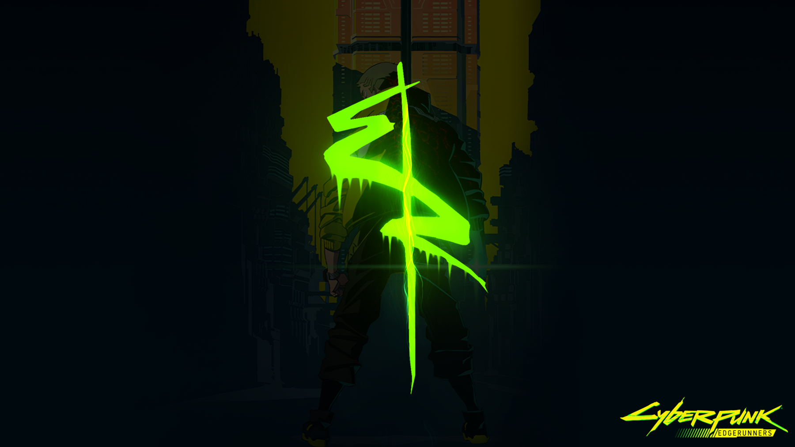
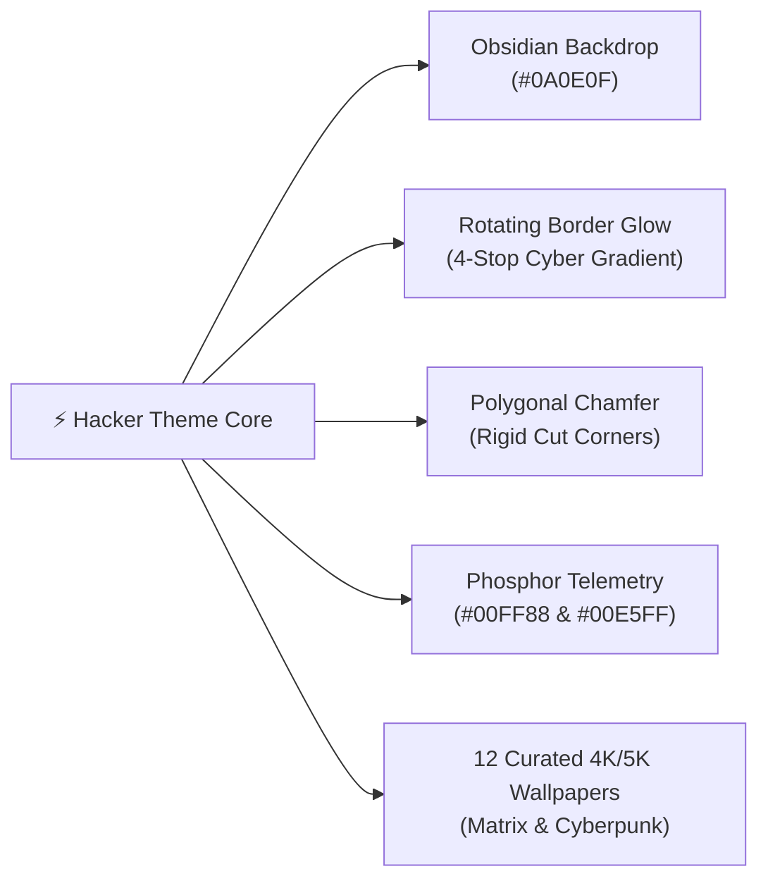

<div align="center">

# ⚡ Omarchy Hacker Theme

### *An Elite, High-Contrast Cyberpunk & Obsidian Matrix Theme for Omarchy & Hyprland*

[](https://archlinux.org/)
[](https://hyprland.org/)
[](https://omarchy.org/)
[](backgrounds/)
[](LICENSE)

<br/>

```
  [ SYSTEM INFILTRATION COMPLETE ]  •  PHOSPHOR NEON GLOW  •  4-STOP ROTATING GRADIENT
```

<br/>



</div>

---

## ⚡ 1-Command Instant Installation

Install and activate the complete Hacker Theme in one step using the official Omarchy CLI:

```bash
omarchy theme install https://github.com/ayush-rdev/omarchy-hacker-theme.git && omarchy theme set hacker
```

---

## 💎 Architectural Highlights



### 1. ⬛ True Obsidian Depth (`#0A0E0F`)
* Deep black charcoal backdrop engineered for late-night sessions with zero eye strain, OLED power conservation, and razor-sharp contrast against phosphor accents.

### 2. 🌀 Animated 4-Stop Continuous Cyber Loop
* A continuous animated rotating border gradient smoothly interpolating through Neon Phosphor (`#00FF88`), Electric Cyan (`#00E5FF`), Ice Blue (`#38BDF8`), and Deep Slate.

### 3. 📐 Polygonal Chamfered Geometry
* Non-traditional rigid angular corners (`rounding = 8`, `rounding_power = 1.0`) providing a high-tech tactical cyber-deck aesthetic rather than soft consumer squircle shapes.

### 4. 🎯 Semantic ANSI Integrity
* Unlike traditional green monochrome rices that tint all terminal output (breaking compiler errors, git diffs, and test suites), the Hacker palette maintains rigorous semantic color boundaries.

---

## 🎨 Palette Architecture

| Role | Color Name | Hex Code | Visual Swatch | Semantic Purpose |
| :--- | :--- | :---: | :---: | :--- |
| **Background** | Obsidian Charcoal | `#0A0E0F` | `⬛` | Deep eye-friendly backdrop with maximum contrast |
| **Active Accent** | Phosphor Neon Green | `#00FF88` | `🟩` | Primary cursor glow, active tab indicator, prompt glyph |
| **Secondary Glow** | Electric Cyan | `#00E5FF` | `🟦` | Telemetry gauges, URLs, active window border stop |
| **Tertiary Accent**| Ice Blue | `#38BDF8` | `🔷` | Border gradient anchor & system status indicators |
| **Foreground** | Mint Crisp White | `#E1E8E6` | `⬜` | High-readability terminal text & UI typography |
| **Error / Alert** | Crimson Rose | `#F43F5E` | `🟥` | Deletion diffs, auth errors, failed compile assertions |
| **Warning** | Amber Gold | `#EAB308` | `🟨` | Git dirty state, warnings, high CPU / memory thresholds |

---

## 🖼️ Curated 4K & 5K Wallpaper Matrix

The theme includes **12 curated ultra-high-resolution wallpapers**. Cycle them dynamically at any time:

```bash
# Cycle to next wallpaper
omarchy theme bg next

# Open the visual GUI wallpaper picker
omarchy menu wallpaper
```

| # | Filename | Resolution | Description / Aesthetic |
| :-: | :--- | :---: | :--- |
| **1** | `1-cyberpunk-neon-green.png` | 2560 × 1440 | Cyberpunk neon green anime aesthetic |
| **2** | `2-arch-workstation.jpg` | 3000 × 1686 | Arch Linux battle station & dual-screen terminal |
| **3** | `3-lain-night-terminal.jpg` | 3996 × 2250 | Serial Experiments Lain CRT cyber-deck |
| **4** | `4-cyber-interface.jpg` | 4552 × 2580 | Holographic telemetry HUD interface |
| **5** | `5-matrix-code-rain.png` | **5120 × 2880 (5K)** | High-density vertical matrix glyph cascade |
| **6** | `6-matrix-falling-code.jpg` | 3840 × 2160 (4K) | Phosphor green cascading matrix code stream |
| **7** | `7-cyber-shinjuku-night.jpg` | 3840 × 2160 (4K) | Tokyo cyberpunk alleyways soaked in neon glow |
| **8** | `8-cyber-geometric-grid.jpg` | **5000 × 3542 (5K)** | Dark vector geometric grid with cyber lines |
| **9** | `9-stealth-mono-rain.jpg` | 3840 × 2160 (4K) | Stealth monochrome dark digital glyphs |
| **10** | `10-neon-green-street.jpg` | 3840 × 2160 (4K) | Rain-soaked cyber street reflecting emerald lights |
| **11** | `11-dark-circuit-nexus.png` | 1920 × 1080 | Minimalist dark motherboard / circuit traces |
| **12** | `12-hacker-command-center.jpg` | 3840 × 2160 (4K) | Atmospheric late-night mainframe workstation |

---

## 🖥️ Recommended Hyprland Look'n'Feel

For the signature rigid chamfered cut corners and rotating border glow, add or verify this configuration in `~/.config/hypr/looknfeel.lua`:

```lua
hl.config({
  general = {
    gaps_in = 2,
    gaps_out = 4,
    border_size = 1,
  },

  decoration = {
    -- Rigid angular chamfered/cut corners (benzene / cyber polygonal aesthetic)
    rounding = 8,
    rounding_power = 1.0,
  },
})

-- Continuous animated 4-stop rotating cyber gradient
hl.animation({ leaf = "borderangle", enabled = true, speed = 25, bezier = "linear", style = "loop" })
```

---

## ⌨️ Recommended Keybindings

Add to `~/.config/hypr/bindings.lua` for effortless control:

```lua
-- Cycle cyberpunk wallpapers on demand
o.bind("SUPER + W", "Cycle Hacker Wallpaper", "omarchy theme bg next")

-- Launch matrix digital rain screensaver
o.bind("SUPER + ALT + M", "Matrix Screensaver", "omarchy-launch-tui cmatrix -ab -u 2")
```

---

## 🪟 Comprehensive App Support

Automated templates are installed across your entire workflow:
* **Terminals**: Foot, Ghostty, Kitty, Alacritty
* **Status Bar & Menus**: Quickshell (Omarchy Quattro status bar, lock screen, popups, and OSD)
* **Text Editors**: Neovim (`bjarneo/aether.nvim`), VS Code, Helix
* **System Monitoring**: Btop, Starship prompt, Fastfetch, GTK 3/4

---

## 🧹 Uninstallation

To remove the theme and return to an Omarchy default:

```bash
omarchy theme remove hacker
omarchy theme set "Tokyo Night"
```

---

## 📄 License

Crafted with discipline by [ayush-rdev](https://github.com/ayush-rdev).
Released under the **[MIT License](LICENSE)**.
